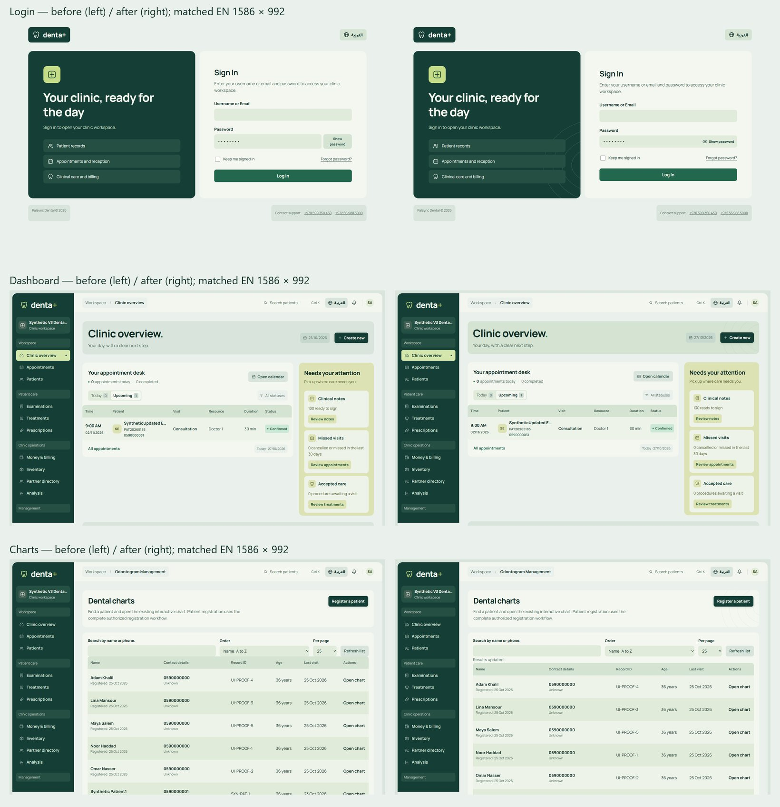
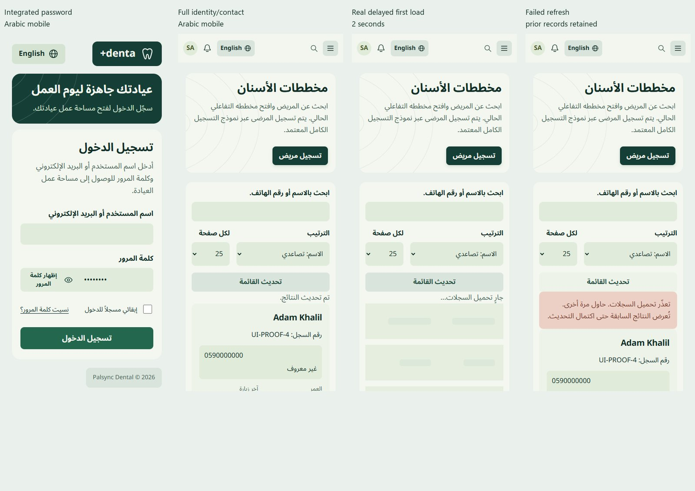
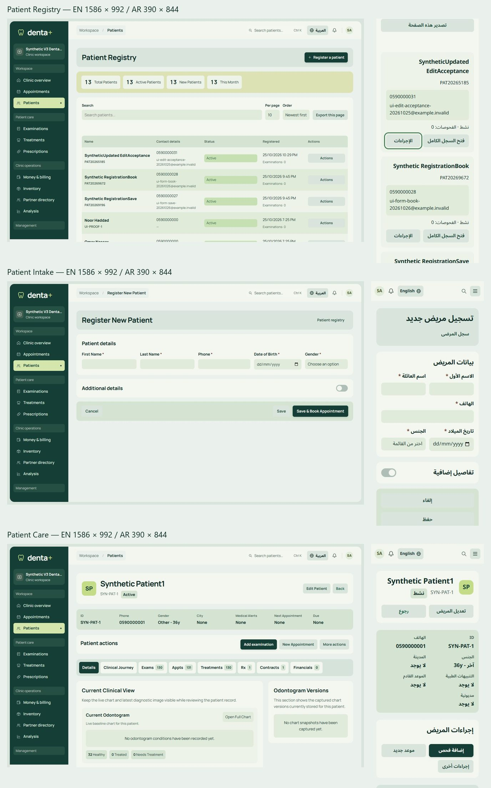
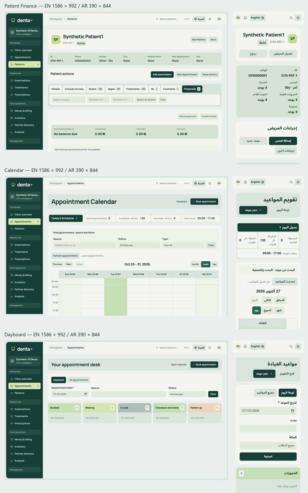
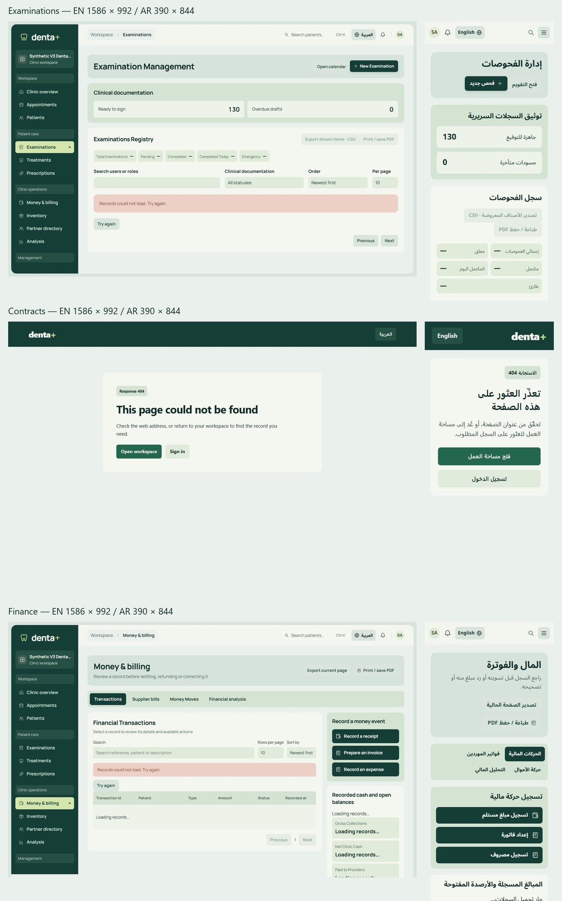
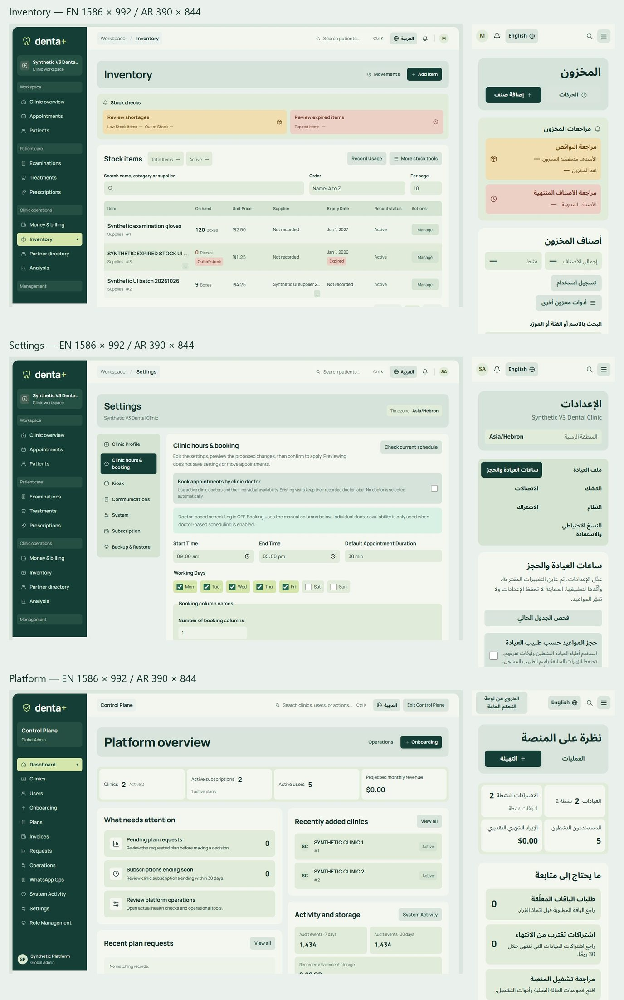
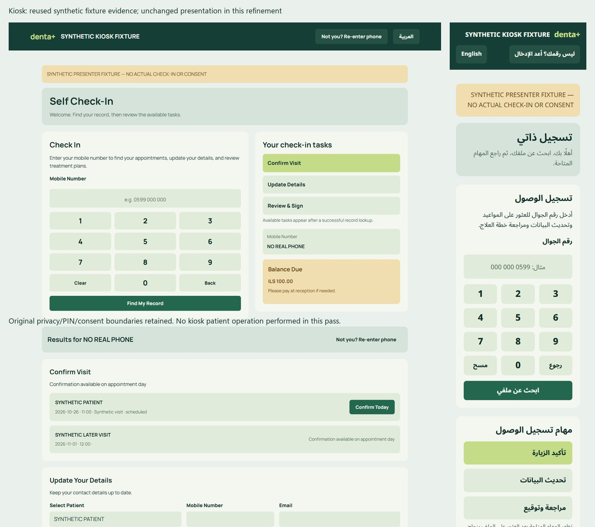

# Studio craft and loading review

This is a portable GitHub-readable gallery of real, disposable-synthetic CI4 screens. Click an image to inspect its full resolution. Full-size source captures remain outside Git at `C:/Users/bassa/AppData/Local/Temp/denta-ui-v3-20261023/studio-craft/index.html` (double-click to open). Contact sheets resize screenshots; they do not replace application content.

**Acceptance:** the Owner accepted the dashboard direction and selected components. The broader Studio system and this refinement remain **pending Owner full visual acceptance**. Independent review 5664422143 is COMMENTED at `5f1f97e`, not approval. The automated reviewer is quota-blocked; no duplicate request was sent. This gallery is evidence, not a claim of visual approval.

## Matched before / after

Login, dashboard and chart-directory headings at the same EN 1586×992 viewport and synthetic state. Original static contours remain on these three non-data surfaces only. They do not appear on clinical records, finance rows, forms or signed/printed evidence.

## Components and real asynchronous states

Password suffix, full mobile identity/contact, actual delayed first load and failed refresh retaining prior records. Shapes are inert and static; no simulated records, invented progress, minimum duration or SSR skeletons. The Open Chart action is directly below each record's age/last-visit details, without an extra menu.

## Current workspaces

Each sheet pairs English 1586×992 with Arabic 390×844, from actual application routes. These are current presentation captures, not a re-execution of all clinical/accounting/security acceptance. Desktop grids retain fixed geometry; patient and chart directories now have explicit narrow-screen record equivalents with full identity/contact.

Kiosk presentation is unchanged by this pass. The following real isolated synthetic-fixture captures are reused from the prior kiosk acceptance, explicitly distinguished from newly executed browser checks. Original PIN, allowlist, timeout and privacy boundaries remain protected.

## Component Fit Matrix

Severity describes the observed UX problem, not a newly discovered backend vulnerability. FIXED means implemented and locally checked; it does not mean Owner-approved.

| Route/state | Component / user task | Observed problem | Chosen component and preserved interaction | Severity | Evidence / status |
|---|---|---|---|---|---|
| Login, reset/change, staff and platform/onboarding | Enter or check a password | Detached Show button; changing label mixed with pressed state; other fields inconsistent | Shared native-input suffix, eye/short label, unique field-specific accessible name; no aria-pressed; selection preserved; hidden initially/on submit; autocomplete/names/rules retained | Medium | Login mobile/desktop; staff multi-field and onboarding; FIXED |
| Login at 320px AR | Reach language switch | Brand + language overflowed by 8px | Content-sized header spacing at <=360px; both controls retained | Medium | 320/390/768 EN/AR; FIXED |
| Dashboard, access introduction, chart directory | Orient without distraction | Flat undifferentiated non-data header | Three selective static theme-coloured contour surfaces; original copy/actions intact | Low | Matched before/after; FIXED, Owner depth judgment pending |
| Chart directory, 320/360/390 EN/AR | Identify patient, open chart | Desktop columns clipped name/contact | Full record identity/contact + direct existing chart link; same sorted/paged response, no second request | High usability | Initial 40-assertion pass and mobile captures; FIXED |
| Patient registry, 320/360/390 AR | Identify/contact patient | New gallery exposed the same desktop-table clipping | Mobile record presentation with full identity/contact, direct record access and original permitted actions; same DataTables pagination | High usability | Six mobile/focus assertions; FIXED |
| Chart, patients, stock: first delayed response | Understand loading | Blank or generic text without expected geometry | Shared inert row/list shapes after 300ms; immediate data is never delayed; stable surrounding controls | Medium | 600ms stock and 2s chart response capture; FIXED |
| Same lists: refresh/search/page | Keep context while querying | Stock hid table; charts cleared records; stale failure could erase useful results | Retain previous bounded results, localized updating/stale status, aria-busy, disabled stale pagination; superseded requests aborted/version-checked | Medium | Refresh/error/retry/rapid chart search; FIXED |
| Same lists: failure/denial/timeout | Recover honestly | Infinite waits; generic empty/error ambiguity | 12-second fetch bound, retry, explicit denied-access wording; clear records on denied access, retain on transient failure | Medium | HTML 403 and actual timeout check; FIXED |
| Clinic and platform command search | Find existing entity | Busy state with little feedback; unbounded request | Shared delayed shapes, prior-result label, version protection and timeout; existing session/Control Plane routes retained | Medium | Clinic search/Escape; source inspection of shared platform lifecycle; FIXED, full platform slow/error matrix not re-executed |
| Notifications | Read actual notifications | Empty busy panel / unbounded wait | Delayed inert list shapes and bounded request; original error/retry and no-send behavior retained | Medium | Source inspection; previous notification workflow evidence reused; no new sending/configuration |
| Patient care/finance | Find primary care actions | Five or six actions competed equally | Examination and booking remain visible; secondary existing actions use the established keyboard-accessible menu; all permission checks/forms retained | Medium | Current care/finance sheet, real treatment drawer/Escape; FIXED |
| Patient history | Scan existing clinical/finance categories | Dense set of tabs | Existing semantic tab navigation retained; secondary action pressure reduced above it; no hidden history or invented default tab | Low | Current care/finance sheet; PRESERVED, Owner density judgment pending |
| Contextual drawer | Escape and return to work | Quick Escape could race queued opening/focus; hidden-menu opener could strand focus | Cancel queued opening/init after close; return to visible menu summary; preserve native forms and focus trap | Medium | Real patient drawer + fast Escape; FIXED |
| Finance decisions | Understand consequence and subject | Generic review/continue text | Existing action name and invoice/record identity, specific confirm label, unchanged reason/CSRF/request bodies | Medium | Four decisions cancelled without writes; Arabic reason capture; FIXED |
| Valid native POST forms | Avoid duplicate submission | Weak pending feedback | Localized submitter pending state after validation/handlers; successful fields remain enabled; duplicate native submit blocked; pageshow restores controls | Medium | One intercepted synthetic probe retained field and submitter values; FIXED |
| Clinic detail administration | Find access, subscription, billing, communication, lifecycle | Long page loses navigation | Existing five anchors retained and sticky on desktop; destructive lifecycle section remains separate; no privileged action on navigation | Medium | Real anchor navigation and platform sheet; FIXED |
| Calendar/dayboard | Read real statuses and scheduling | No new confirmed component defect in this pass | Existing calendar/dayboard controls and disabled scheduling gate retained | — | Current matched sheet; PRESERVED |
| Intake/clinical/agreements | Enter data; preserve signed evidence | Risk of style pass changing clinical rules | Existing fields, notes and legal/clinical print evidence retained; no invented medical/tax/signed workflow | — | Current sheets; source guard; PRESERVED |
| Inventory | Locate stock and use existing management | Blank table during refresh | Same actual inventory producer now retains table; skeleton only first load, retry and original action menu | Medium | Seven focused stock observations and current sheet; FIXED |
| Settings / roles / reports | Administer existing application | No verified new policy need | Existing UI/component system retained, feature switches unchanged | — | Settings capture and prior management acceptance; PRESERVED |
| Kiosk | Private touch-first verification | No change needed for password/async directory work | Reuse unchanged kiosk implementation and prior synthetic PIN/result/contract evidence | — | Clearly labelled reused gallery; PRESERVED |

## Focused validation and limits

- Initial pass: 40 successful assertions covered chart EN/AR at 320/360/390/768/1366/1586, password selection/independence, delayed loading, empty/error/retry and rapid replacement search. Its final inventory selector was a harness error (patient selector on a different component), not treated as a pass; the actual stock producer was subsequently tested directly.
- Seven stock loading/refresh/error/retry observations; four finance decision headings/labels and cancellation, plus clinic search/Escape; 16 final auth/platform checks; seven denial/timeout/reduced-motion/drawer/native-submit checks; six patient-registry mobile/focus checks. Runtime errors: none in the completed focused runs. Business writes were blocked. One ephemeral synthetic POST probe was intercepted, preserving its successful field/submitter values.
- Corrected harness issues are retained outside source: confirmation awaited a user decision before clicking it, and an authenticated login check correctly encountered the redirect. Neither is recorded as an application success. The real 320px header overflow and fast-Escape race were corrected and confirmed.
- All 11 fingerprinted synthetic business tables match before/after. No production/customer database, migrations, backend/controller/model/service/configuration, native chart algorithms/SVG, signed evidence, dependency or feature-switch changes in this pass. Existing exact source-boundary guard remains strict.
- Shared shapes are static in all motion modes. The patient-directory status row/initial page reserve geometry rather than removing a loading block and moving pagination. No clinical or finance operation uses a skeleton in place of pending submission. No new API calls or dependency. Password-manager autocomplete attributes/paste remain native; proprietary third-party password-manager extensions and physical screen readers were not exercised.
- Prior tenant/role/CSRF/accounting evidence is reused for unchanged authority. This pass is not fresh SQL/security certification or a production release gate.

## Performance and maintenance

The changed CSS/JS set grows from 82,516 to 98,664 bytes uncompressed (exact receipt stored with the local evidence). The loading helper and shared native controls add two small scripts to clinic/platform pages; access already loaded its control script. Motifs add zero requests; no new API calls, framework, runtime dependency, font or animation. The full curated gallery is approximately 1.7MB and is not loaded by application routes.

Current single local desktop navigation samples include registry 469ms, intake 428ms, patient care 2599ms, patient finance 557ms, calendar 448ms and dayboard 425ms. These are whole-document browser timings under synthetic local conditions, **not** a production benchmark or a causal before/after speed claim. A same-viewport, change-relevant 1366px patient-directory comparison measured CLS 0.2549 before the loading-geometry correction and 0.00086 after it (no long tasks in either sample; request count stayed 18). First contentful paint was 212ms in the initial current sample and 220ms after correction; navigation timings vary and do not prove a speedup. Dashboard CLS was 0 and chart-directory CLS 0.0308 in the sampled initial run. A clean paired pre-edit paint/CLS baseline for the entire pass was not captured; historic query/markup evidence is retained and not misrepresented as that baseline. High server query counts and the slow patient route remain separate backend performance limitations. Feedback improves context/recovery, not server execution speed.

## Existing limitations and release disposition

1. Chart-history preview's pre-existing `tooth1` / `tooth-1` mismatch remains open (clinical interpretation risk). Native interactive chart lookup/rendering is unchanged. Do not certify the affected history preview before its separately authorized fix.
2. Pre-existing draft agreement item-sync defect remains open (missing-plan-item risk). Do not certify contract creation/item preservation from a visual screenshot; separate clinical/business correction is required.
3. No dual-theme frontend implementation. The archived rejected design tag remains preserved; current theme roles remain centralized for future authorized themes.
4. Owner density/depth acceptance, final exact-head independent review and future production release acceptance remain pending. Reviewer quota failure is not approval. Draft PR only; no deployment recommendation from this UI pass.

## Research applied

The password behavior follows [GOV.UK password guidance](https://design-system.service.gov.uk/components/password-input/) while retaining Denta+'s fields and visual identity. Delayed, content-shaped async placeholders and busy semantics follow [Fluent skeleton guidance](https://fluent2.microsoft.design/components/web/react/core/skeleton/usage/). Escape and logical focus restoration follow the [WAI modal dialog pattern](https://www.w3.org/WAI/ARIA/apg/patterns/dialog-modal/). These sources informed component behavior, not replacement business rules.
