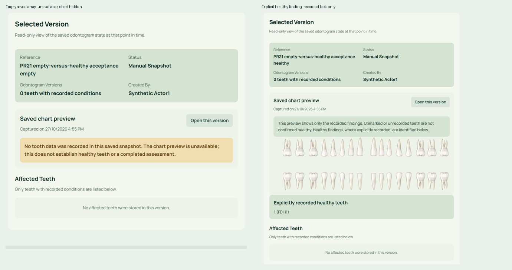
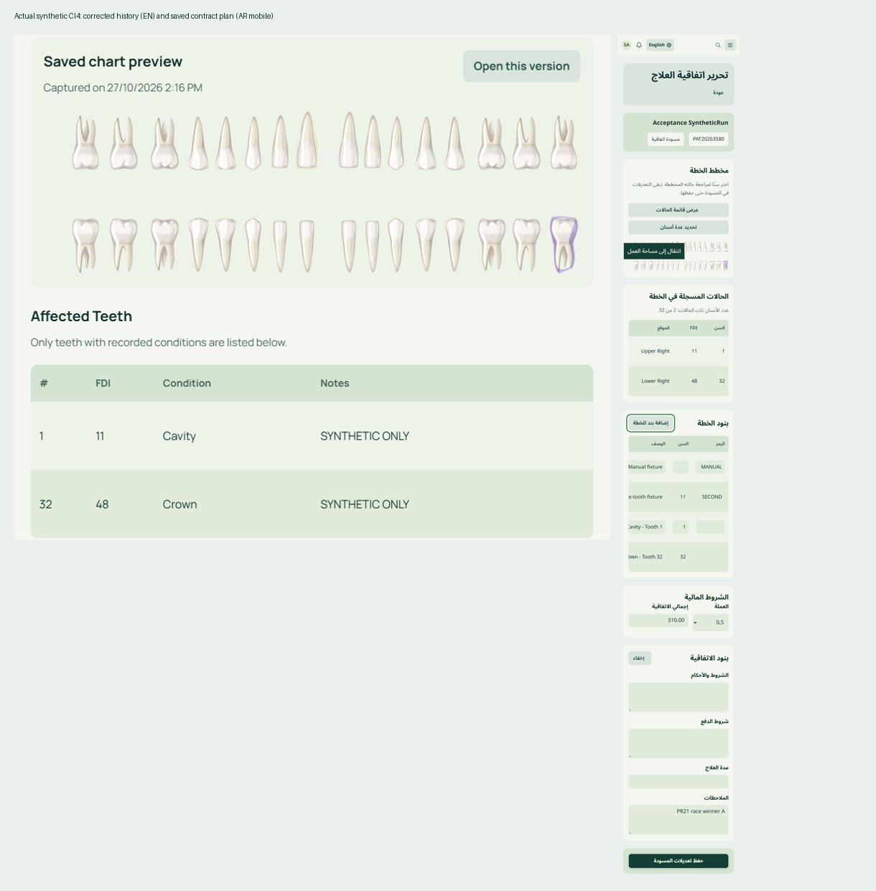

# PR21 — authorized clinical corrections and independent acceptance gate

## Latest narrow correction — empty historical snapshot (review5669868977)

Review5669868977 on d8547f1 provisionally accepted the earlier three corrections but requested one remaining empty-list safety fix. The guard now returns before revealing a chart when saved tooth data is `[]`. English/Arabic copy explicitly says no tooth data was recorded and this is not evidence of healthy teeth or completed assessment. Invalid/null data retains the separate unavailable warning. Valid previews have a persistent recorded-findings-only scope notice; explicitly saved healthy teeth are listed separately, with unchanged numbering/FDI labels. Unrecorded teeth are never asserted healthy. Native SVG, stored snapshots, clinical colors, signed evidence and earlier contract/examination corrections remain unchanged.

[Current empty-snapshot receipt](empty-history-acceptance.json). The new empty-list assertion **failed before** the fix and passes afterward. Actual saved empty and healthy fixtures were added only to the existing guarded disposable database. Twenty real CI4 route observations cover empty/healthy/invalid/null/cavity+crown in EN/AR at390 and1586px, including HTTP200, visibility, translated copy, keyboard focus and reflow. Thirteen mapping/ambiguity browser checks and two existing invalid-document checks pass. All26 snapshot rows are unchanged across browser reads, all24 preexisting snapshot hashes match their pre-fixture values, and the339 original business rows/schemas remain unchanged. No broad suites repeated; no production access, migration or activation. Source guard, SaaS guardrails and PHP/JS checks pass. Independent acceptance of this new head remains pending; keep Draft.



Full new EN/AR captures remain in the existing external `final-acceptance` directory (`empty-fix-*.png`). The historical surgical correction evidence below remains valid; its runtime pin describes that earlier evidence, not the latest empty-state source.

**Recommendation: ready for independent exact-head correction review; keep PR21 Draft. No merge or deployment approval.** The accepted Studio design is preserved. The three failures in [review5667106157](https://github.com/Bassamalsaqqa/dental-saas/pull/21#pullrequestreview-5667106157) have been corrected under explicit Owner authorization and locally checked with real SQL and browser workflows. They are not yet independently accepted.

Runtime source freeze: `a10b0985c3f50d90bec27cd4c9dc8f8d3dbd7ebf`, tree `f4546b22e2f1499ef11411e9041c34345b9a49a1`. Subsequent packaging changes contain evidence/tests/governance only. The final published PR SHA/tree is recorded in the review handback, avoiding self-referential commit metadata.

- [Current sanitized acceptance matrix](surgical-acceptance.json)
- [Original before-correction receipt](acceptance.json) and [historical report at5785e4c](https://github.com/Bassamalsaqqa/dental-saas/blob/5785e4c71902e06b61c2bb08a021b34ad7a3be20/docs/ui-evidence/final-acceptance/README.md)
- [Existing frontend/gallery evidence](../modular/README.md)
- Local actual-page correction gallery: `C:/Users/bassa/AppData/Local/Temp/denta-ui-v3-20261023/final-acceptance/surgical-gallery.html` (double-click). Full captures/private harnesses stay outside Git.



## Corrections and before/after evidence

| Area | Failing before at5785e4c | Corrected behavior | Primary commit |
|---|---|---|---|
| Draft contract | Persisted priced tooth11 line classified auto, dropped on chart refresh, then soft-deleted by resave | Persisted IDs/provenance retained; suggestions separated; every saved ID must be submitted or explicitly removed; stale/incomplete/forged submissions reject under existing draft locks; equivalent row bytes preserved | `3e5675a` |
| Historical preview | toothN lookup misses native tooth-N groups; actual saved conditions have no overlays | Validate exact unique IDs and entire batch before paint; invalid/ambiguous/missing/unsupported data shows unavailable with text retained; visible original color overlays | `c25abcc` |
| Examination | Narrative persisted, then undefined previousStatus produced500 | Locked previous state; mandatory narrative/audit/completion snapshot share one checked transaction; edit/completion/sign serialize; best-effort follow-up after commit; truthful retry response | `4738101` |

Bounded follow-ups in the same correction scopes: `60ae805` rejects nested form types before coercion; `3f9708e` keeps invalid/null saved JSON unavailable; `381a581` owns locked signed-state queries in the existing governance service; `a10b098` prevents a transparent native base shape from making the new historical crown overlay invisible. These are ordinary commits, without history replacement.

Visual inspection found the crown's cloned native shape had opacity0 despite a correct fill attribute. The preview now explicitly uses opacity1 and retains fill-opacity0.38 and the original colors. Computed browser colors are cavity rgb(250,204,21) and crown rgb(139,92,246); both are visible. Native SVG assets, interactive chart algorithms, numbering/FDI labels, stored snapshot bytes and signed evidence are unchanged. Multiple conflicting conditions on a single tooth are reported unavailable rather than flattened to a guessed color. This preserves the application's existing numbering contract; it does not certify or redefine clinical numbering conventions.

Contract updates retain row identity instead of delete/reinsert. Explicit removals remain soft-deletes. Revision validation covers current contract/items/frozen snapshot under existing clinic/patient/exam/contract/item locks. No automatic billing, provider obligation or signed-document change is introduced. On incomplete/stale validation, the user must reopen and review the draft; rejected writes preserve the stored plan.

Examination locking is clinic -> numerically ordered patient(s) -> examination -> signature. Completion shares that boundary and only first completion captures a baseline. Deletion rechecks signing under its existing financial-parent deletion locks. Strict snapshot insertion failure is opt-in for these authorized examination paths; empty baselines retain null behavior. Mandatory activity failure rolls back the save. Transaction-depth checks prevent nested callbacks from falsely reporting a committed save. Signing reads its persisted snapshot state before commit. No clinic-scale lock-capacity claim is made.

## Actual acceptance, with scope distinguished

All mutations target new owned fixtures in `denta_pr21_acceptance_20261027`, the existing dedicated MariaDB on127.0.0.1:3307. Separate HTTP/writable/session credentials are retained privately. The original synthetic seed, original preview, original checkout and historical forensic staging are preserved. No migrations were run. Required-write fault triggers were scoped to owned examination IDs and removed in finally blocks.

| Workflow | Evidence type | Result / limit |
|---|---|---|
| Reopen/manual/tooth/same-tooth contract plans, equivalent resave, authorized edit/removal, validation retry/cancel, stale duplicate | Actual routed browser forms + full SQL item rows | PASS: IDs and unchanged fields persist; omissions/invalid inputs leave original rows intact |
| Concurrent contract updates | Two HTTP servers and independent sessions contending on real MariaDB clinic lock | PASS: one fresh revision commits, stale contender rejects, original item rows intact |
| Foreign/nested item identity and revision forgery | Actual routed POST + SQL | PASS: safe rejection, no500, no row changes |
| History1/16/17/32, cavity/crown/healthy, missing/invalid/duplicate IDs, unsupported types, missing/duplicate SVG groups, legacy ambiguity | Actual saved CI4 page + DOM-only malformed fixtures | PASS; malformed edge cases are not represented as persisted clinical tests |
| Invalid/null saved JSON | Separate new owned snapshot records + actual CI4 page | PASS: HTTP200, preview hidden, unavailable warning visible; original saved records untouched |
| Draft edit, completion, permitted unsigned completed edit, validation, identical retry, signing and signed denial | Actual routed requests + SQL | PASS: response agrees with durable state; one completion snapshot |
| Required activity/snapshot failures on update and completion | Real MariaDB failure triggers + actual routed saves | PASS: narrative/audit/snapshot rows roll back together; later retry commits once |
| Edit-first/sign-first/duplicate-sign races | Independent PHP processes and actual MariaDB connections | PASS: signed snapshot equals durable narrative; signed edit denied; one signature; no observed deadlocks |
| Owned transaction failure, nested transaction violation, cross-clinic denial, signing/immutability | Tracked real-SQL regression | PASS9 assertions; service evidence, not routed RBAC evidence |
| Restricted-role direct clinical/contract/payout/platform POSTs, missing CSRF | Actual routes with genuine restricted session | PASS; no permission relaxation |
| Session/Bearer isolation, mandatory clinic header, unauthorized clinic, Bearer-only attempt at session search | Actual independent sessions/tokens/routes | PASS; no inherited authority |
| Platform entry, tenant search airlock, impersonation/exit, global-surface denial, Bearer separation | Actual synthetic platform session and routed transitions | PASS; first-party App API over local HTTP remains426 by design, not newly TLS-certified |
| Provider allocation, partial payout, mark-paid and repeat | Actual enabled existing finance routes + SQL | PASS: gross/share/original invoice preserved; only remaining obligation paid; no duplicate history |
| Contract-signature featureOFF | Actual routed request | PASS404 without activation; no new successful routed consent claim; unchanged M2 signing evidence reused |
| Corrected contract/exam/history EN/AR390/820/1586 | Actual CI4 rendering, reflow, keyboard focus and JS-error observation | PASS representative checks; not formal accessibility/device certification |
| Registration, appointment create/edit/conflict/status, invoice receipt/refund, original signed-note protections | Earlier actual SQL receipts, reused | No repetition of accepted broad suites; see original receipt |

The JSON contains88 scoped routed/browser observations plus the separately executed9-assertion service SQL test. These are different evidence types, not a claim of complete workflow or accessibility certification.

## Preservation and scope

- All339 original copied business rows across15 tables match; schemas match. Eleven original-preview table fingerprints match the preserved pre-campaign baseline.
- Native SVG/current chart source, models, Config/schema/migrations, ContractSigningService, canonical finance services and Composer/npm manifests/locks are unchanged against5785e4c. Exact authorized backend exceptions remain pinned by the source guard.
- Corrections, checkout, derivatives, contact history, dynamic scheduling, contract signatures and WhatsApp entitlement remainOFF in the isolated effective configuration. No feature/configuration/permission was changed in production.
- GitHub release remains89352fd; main remains485a198. No live production contact was performed; the prior deployment receipt remains the last recorded installed-source evidence.
- SaaS and exact protected-source guards pass. A preexisting stale DOM allowlist note remains visible; no guard was weakened. GitHub reports0 workflow files; no Actions were run.
- No new CSS/assets/dependencies or redesign. The approximately442-query patient profile is still a separately scoped backend concern, not a claimed performance improvement.

## Reproduction and retained evidence

```text
node scripts/ci/pr21_contract_items_regression.cjs
node scripts/ci/pr21_history_preview_regression.cjs
php tests/regression/Pr21ExaminationTransactionSql.php --bootstrap=<existing guarded private synthetic bootstrap>
php scripts/ci/frontend_rebuild_guard.php
bash scripts/ci/saas_guardrails.sh
```

`pr21_clinical_characterization.cjs` is explicitly pinned to5785e4c and succeeds when it reproduces the original defects. It is **not** a corrected-behavior test. Its process buffer was increased to read the unchanged large SVG; that harness issue did not change clinical expectations.

Private route/fault/concurrency runners, seed and full SQL receipts remain in the existing external `final-acceptance` directory. They require the guarded synthetic instance and are not public production utilities. The tracked SQL runner refuses the original/business/production DB, wrong source root, root account, wrong instance/port and unowned patient. No fixture credentials, sessions, `.env`, raw diagnostic logs or customer data are published.

## Remaining decisions / untested boundaries

- Independent exact-head acceptance is pending; earlier COMMENTED review is not an approval of these corrections. Keep draft, no merge/deploy.
- Medical assessment provenance remains separate: historical0 is not reinterpreted as assessedNo. Existing safe warning remains. Owner must decide future Unassessed/No/Yes policy/provenance before any storage change.
- Contract-signing success was not re-enabled for a new browser test; featureOFF is intentionally preserved. Native Hostinger/filesystem work is reused from earlier M2 evidence, not rerun or claimed newly certified.
- Physical assistive technology, native browser zoom, hardware touch/password managers and full device matrix remain untested. No formal WCAG compliance claim.
- Earlier large patient query count, existing numbering semantics and unrelated workflows were not redesigned or silently changed.

**Engineering handback: the three demonstrated failures are locally corrected with auditable evidence. Ready for independent assessment of the actual final head, not release authorization.**
