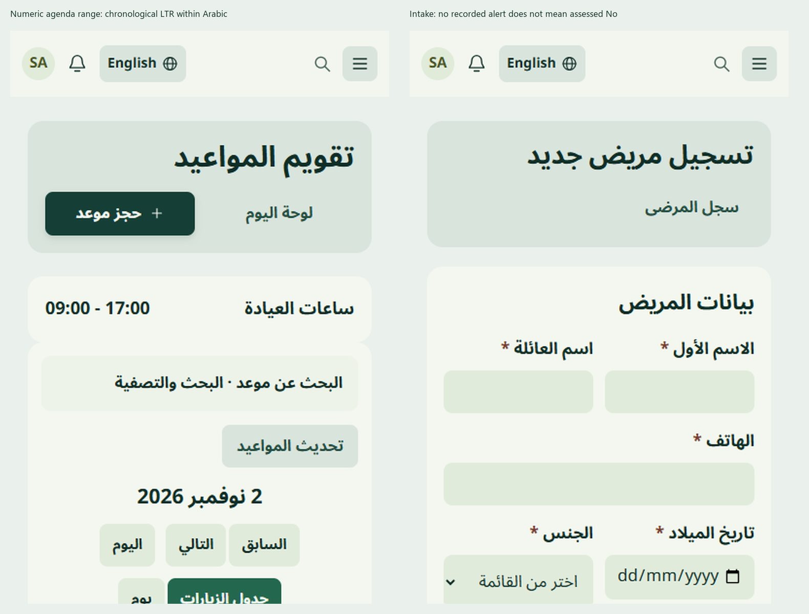

# PR21: actual workflow certification and protected correction gate

**Recommendation: BLOCKED for final acceptance, merge and release.** The Studio visual foundation remains accepted. This pass performed real SQL-backed application actions rather than treating screenshots or intercepted requests as persistence. It found three concrete protected clinical/backend defects. None was fixed, waived or reclassified as accepted.

Starting source:27bc01ec3865224b1cb0dd78b037b815a0fbdf3a /28ef8eb72399bde4dfff22efbfaa4a9c2d3413d6. Independent review5666649981 is GitHub COMMENTED with an explicit changes-required verdict. Current release ref89352fd is preserved. No production access or GitHub Actions.

## Isolation and recoverability

A new `denta_pr21_acceptance_20261027` database was restored from a consistent synthetic-only dump of the existing preview database on the already-owned MariaDB instance127.0.0.1:3307. Before creation, the target was absent and the instance/datadir identity matched the preserved dedicated disposable instance. No existing database/datadir was overwritten. A new restricted DB actor and separate writable/cache/uploads/log/session tree were used; every HTTP request failed closed unless the exact new database/port was active. Authentication used a separate cookie/session. The old57131 preview was not switched to this target.

The local acceptance server used127.0.0.1:57321 after Windows denied binding57132; no existing process was terminated and no system networking configuration changed. SQL seed, private instance credentials, sessions, full diagnostics and screenshots remain outside Git at `C:/Users/bassa/AppData/Local/Temp/denta-ui-v3-20261023/final-acceptance/`. Preserve them. The seed is a reproducible restore point for another explicitly owned disposable target; never restore it over production or the existing preview. No migrations were run.

Original-source synthetic DB:11 business-table fingerprints remain unchanged. In the acceptance clone, **339 pre-existing rows across15 business tables match their originals**, and schema metadata matches. Actual workflow writes affect only newly owned synthetic records; logs/auth metadata in the disposable target may change as expected. Synthetic signatures are test evidence, not real patient consent. No production/customer data was used.

## Actual routed workflow matrix

All below used manager role in synthetic clinic1 unless stated. HTTP responses, redirects and database state were independently checked; the test harness preserves failed assertions instead of converting them to passes.

| Workflow / source route | Action and actual result | Persistence / security classification |
|---|---|---|
| `/patient/create` → `/patient/store` | Invalid names/date/phone rejected; corrected synthetic patient saved and reopened with identity | **PASS actual persistence**; invalid request made no patient |
| Same form, missing CSRF | Direct forged POST made no patient | **PASS denial**, not success |
| `/appointment/create` | Booked new patient, edited10:00→11:00 and re-read; conflicting11:00 booking made no second appointment | **PASS actual persistence/conflict** |
| `/appointment/{id}/transition` | Allowed confirmed state persisted; invented stage422 left confirmed state intact | **PASS actual state/denial** |
| `/examination/create` | Synthetic draft persisted; reopen and edit stored changed narrative | **FAIL workflow:** edit wrote changes then returned500; undefined `$previousStatus` at `Examination.php:502` |
| `/examination/{id}/complete` and clinical-note/sign | Completion persisted; one signature persisted; repeat signing made no duplicate; subsequent signed edit did not change narrative | **PASS actual completion/signature/immutability**, separate from the broken draft-edit response |
| New patient's chart before fixture seeding | Draft/completion actions did not write baseline conditions | **PASS baseline separation**. Later explicit reproduction-only fixture deliberately inserted two new owned baseline conditions |
| `/contracts/create/{patient}` | Actual draft with tooth11/qty1/price125 persisted server-side | **PASS create/storage only** |
| `/contracts/{id}/edit` | Server delivered the priced item in initialItems; browser removed it because no matching condition existed | **FAIL synchronization**, not a render-success claim |
| Same owned draft, actual resave | Original tooth11/125 item was soft-deleted; current synthetic condition teeth1/32 became zero-price auto items | **FAIL confirmed data-loss workflow** on a disposable draft. Existing records outside the fixture unchanged |
| Separate manual no-tooth item | Server stored it; reopen retained its code/price25 | **PASS bounded equivalent case** |
| Contract cancel | Back/cancel left stored draft items unchanged | **PASS cancellation** before destructive resave reproduction |
| Contract signature endpoint | Existing plan feature `contracts.signature.enabled` remained OFF;404 retained draft and no attachment | **EXPECTED FEATURE-GATE DENIAL**; successful signed-contract publication/edit/delete/retry not freshly certified. No feature bypass/activation |
| Contract validation failure/retry | Full state-preservation cycle not certified because reopen/resave already loses priced items | **BLOCKED**, not silently passed |
| `/finance/store` | Invoice100.00 ILS persisted with correct currency/total | **PASS actual persistence** |
| `/finance/{id}/payments` | Receipt40 persisted once with actual treasury-account attribution; invoice amount_paid40/balance60 | **PASS actual payment/balance**. Initial harness incorrectly supplied `cash` as an account key; server rejected it. Using the real form payload without an invented override succeeded; no application fix |
| `/finance/{id}/payments/refund` | Separate10 refund history persisted; negative receipt made no extra payment | **PASS actual refund/validation/history** |
| Foreign clinic2 patient | Read403/404; forged clinic1 appointment referencing clinic2 patient made no cross-clinic insert | **PASS isolation denial** |
| Anonymous/Bearer/platform/restricted roles | Earlier source/route evidence retained; not all newly requested role/impersonation/session/Bearer mutation permutations executed | **PARTIAL / REUSED**, no new full security certification |
| Provider payout | Existing source remains unchanged; fresh payout persistence not executed in this pass | **NOT TESTED anew**, not included in payment certification |

Private raw receipts contain full routed diagnostics and SQL state; committed [acceptance.json](acceptance.json) includes only sanitized outcomes. One earlier test asserted draft-update persistence without requiring a successful response; the resulting500 was caught by independent log/response inspection and is explicitly FAILED here. Some fixture/harness failures (wrong signature hash-column name, incorrect tooth-position enum) were corrected against actual schema, not by changing schema/validation. The first synthetic history snapshot was preserved when its subsequent baseline fixture insert failed.

## Clinical defect A: exact historical tooth-ID impact

Actual synthetic snapshot: cavity on universal tooth1 and crown on tooth32. Stored rows were present. The history route's original `container.querySelector('#tooth' + toothNumber)` finds zero groups in the real SVG, which exposes `tooth-1`…`tooth-32`; **zero history condition overlays** render. The list of conditions and existing preview warning remain. The current native interactive chart uses the original hyphenated mapping and correctly rendered both yellow cavity and purple crown overlays.

Impact is omission/under-representation in the historical preview; no wrong-tooth remapping was observed, and persisted findings/snapshot rows were not changed. This can mislead a clinician relying on color instead of the condition list. It remains **HIGH clinical workflow risk / release-blocking for history preview**.

**Separate authorization needed:** narrowly correct history-preview target lookup for validated universal1–32 IDs, with explicit handling for genuinely historical alternate SVG IDs, duplicate/unknown IDs and an honest unavailable state. Preserve saved SVG/JSON bytes, condition meanings/colors, native current-chart algorithm and signed evidence. Tests must include teeth1/16/17/32, absent/invalid/duplicate IDs, mixed conditions, unchanged source snapshot hashes and native-chart nonregression. Do not implement a broad renderer rewrite or silently rewrite old snapshots.

Reproduce without SQL/network: `node scripts/ci/pr21_clinical_characterization.cjs`. Exit0 means the **documented defect is reproduced**, not that the workflow is safe. Actual routed snapshot evidence is separately retained in `final-acceptance/history-reproduction.json`.

## Clinical defect B: draft item provenance/synchronization

`normalizeItems()` marks every persisted item with a tooth as source=auto. `syncItemsFromConditions()` filters those entries out when its current nonhealthy condition list does not contain the tooth. Reopen therefore loses item identity, qty, price and description from the submitted form even though the database initially retains them. The canonical update then soft-deletes all old items and inserts the submitted set. In the owned reproduction, priced tooth11 was removed and current condition teeth1/32 acquired auto zero-price items. A manual no-tooth item remains, demonstrating the specific classification path rather than a universal rendering failure.

**HIGH clinical/financial plan-integrity risk / release blocker.** No protected algorithm or business rule changed.

**Separate authorization needed:** preserve persisted items as explicit plan records regardless of current chart condition. Do not infer removable provenance from tooth_no. Define explicit clinician add/remove/reconcile behavior; retain item identifiers/quantity/tooth/currency/amount unless the operator deliberately edits them; no automatic billable treatments or liabilities. Decide how intentionally removed conditions affect unsaved suggestions versus persisted plan items. Add create→edit→validation→retry→reopen tests for manual/tooth-linked/multiple-same-tooth/priced/historical entries, cancellation, signed-denied requests and duplicate submission. Existing signatures and financial obligations must not be rewritten. The current UI PR must not quietly adopt that accounting/clinical policy.

## Clinical/backend defect C: examination update response after persistence

Actual `POST /examination/1130/update` wrote the changed draft chief complaint then returned500. Local log identifies undefined `$previousStatus` in `app/Controllers/Examination.php:502`, after the model update and activity call. The backend file matches the protected release source. Thus a user may see failure despite a changed clinical record and retry, with uncertain lifecycle/snapshot expectations.

**HIGH reliability/clinical-audit risk / release blocker for draft editing.** No backend patch was made.

**Separate authorization needed:** capture and validate the previous state before mutation in the appropriate tenant-scoped serialized transaction, and ensure narrative update, activity and any newly-completed snapshot succeed or roll back coherently. Review the existing signing lock order before adding locks; do not “fix” only the exception while claiming atomicity. Focused tests: pending→pending, pending→completed, failed audit/snapshot, signed-denied, simultaneous sign/edit and identical retry. Preserve clinical histories and original chart/SVG authority.

## Medical assessment: safe presentation, policy still pending

Storage has boolean/hidden0 controls with no assessment provenance. Historical0 cannot distinguish unanswered from explicitly No. This pass changes **only UI wording**: the zero-alert summary says “Assessment not confirmed”, and intake/patient context explains that no recorded positive does not establish a completed negative assessment. All named inputs, hidden0, checked1, current validation and stored meanings are unchanged. Positive recorded alerts keep their existing warning prominence.

**Clinical Owner decision still needed:** approve explicit Unassessed/No/Yes wording, who may assess and when, whether any fields must be answered, how actor/time/provenance are captured, and how historical0 displays. Recommended safe historical disposition is provenance-unconfirmed until explicitly assessed, never mass-remapped to No. This is a proposal, not a new schema/default/validation policy.

## Safe UI correction and responsiveness

The Arabic agenda showed a numerically reversed-looking09:30–09:00. Actual stored appointment starts09:00, duration30; FullCalendar text is chronological09:00–09:30. Isolating the numeric time range LTR within RTL fixes presentation only; modal time and event time share the numeric direction. Scheduling/event source/doctor authority and feature-OFF state remain unchanged.

Sixteen change-relevant EN/AR patient/intake reflow observations passed at320/390/820/1366, no runtime errors. Prior full-width/container/keyboard/loading evidence is reused. Physical screen reader, native browser zoom, hardware keyboard/touch, password-manager extensions and the entire newly requested device matrix remain explicitly untested. No formal WCAG compliance claimed.

## Deployment authority reconciliation, no production contact

The GitHub protected release ref was read-only verified at89352fd20e0d5166e81f631cb743bead1f596a68. Existing local `release-execution-89352fd-20261023T120943Z/FINAL_RELEASE_REPORT.json` records installed89352fd, tree71fcf67a0def31a99619437169a58ddfabc7b141, previousf86376a4. `PROJECT_STATE.md` now distinguishes that last recorded deployment from its retained older M2 receipt. No live server was contacted; today's actual installation/customer activity is not inferred from a branch name or old report.

## Bounded performance diagnosis

One isolated current patient1 profile issued442 queries including an extra identity guard query. Redacted groups include user63, clinic61, canonical clinic-membership61, role61, granted-permission60 and current-user lookup60 queries. Approximate total database durations per group were12–20ms in this local run. This explains substantial repeated authority resolution but is **not** permission-cache authorization to change security freshness. A subsequent bounded proposal should examine request-local reuse keyed by actor/clinic/global-mode and explicit invalidation, measuring before/after query counts and tenant/role revocation; no cross-request authorization caching should be introduced casually. No backend/performance change here, and no app-wide FCP/INP claim.

## Next gate

BLOCKED. Authorize only the three bounded protected corrections above before critical workflows can be certified; resolve the clinical assessment policy separately. Keep remaining role/finance/provider/gated-signing/AT evidence gaps explicit. Independent exact-head review is not invented or repeatedly requested from the exhausted bot. This candidate may be inspected for the safe copy/time fixes, but **must not merge, deploy, migrate or activate features**.

## Authorized surgical correction A — local implementation checkpoint

Owner explicitly authorized draft-item preservation on 2026-10-27. Saved lines now retain persisted IDs and explicit provenance. Refreshing chart suggestions cannot remove or replace them. Under the existing signing-service transaction and parent/contract/item locks, an exact consent-content revision rejects stale forms; every existing line must be present or explicitly listed for removal. Unknown/duplicate IDs and incomplete/invalid fields reject before writes. Equivalent line values leave original row bytes/timestamps untouched; authorized edits update only changed fields. Deletions remain explicit soft-deletes. No schema, billing, signature evidence or feature-gate change.

Before: the retained 5785e4c characterization and actual SQL receipt demonstrate a lost priced tooth-11 line. After: genuine corrected-behavior Node regression passes; 11 actual browser/routed/SQL assertions pass on denta_pr21_acceptance_20261027: create, saved same-tooth reopen, revision presence, accidental omission, equivalent resave, invalid price rollback, explicit edit with stable ID, stale retry, explicit removal intent, selective soft-delete and cancellation. Current chart suggestions are separately identifiable new lines, not counted as preexisting rows in preservation checks. All 339 original synthetic rows across 15 tables and schema definitions remain unchanged. More concurrent/security acceptance remains pending; this checkpoint is not final clinical certification. No push/merge/deployment.

## Authorized surgical correction B — historical preview

Exact, unique native tooth-N mapping now precedes all overlay painting. A single legacy toothN group is supported only if unambiguous; invalid/missing numbers, duplicate tooth records or elements, mixed old/new IDs, absent shapes and unknown condition types leave the visual preview unavailable with textual clinical history retained. Multiple conflicting conditions on one tooth are not flattened to a guessed single color. Healthy records are supported. The existing color constants, universal/FDI mapping, native interactive SVG/algorithms and every persisted snapshot remain unchanged.

Corrected-behavior synthetic DOM regression passes. Thirteen actual browser checks pass: saved cavity/crown facts on native groups, four universal extremes, healthy, missing/invalid/injection IDs, duplicate rows, unknown conditions, missing/duplicate SVG groups, ambiguous old/new identity, single legacy identity, and saved snapshot byte preservation. Original saved fixture and native interactive code were not rewritten. Malformed edge cases are browser-only fixtures, not customer-data mutations. FDI labels continue to use the unchanged existing application numbering contract; no renumbering is introduced.
