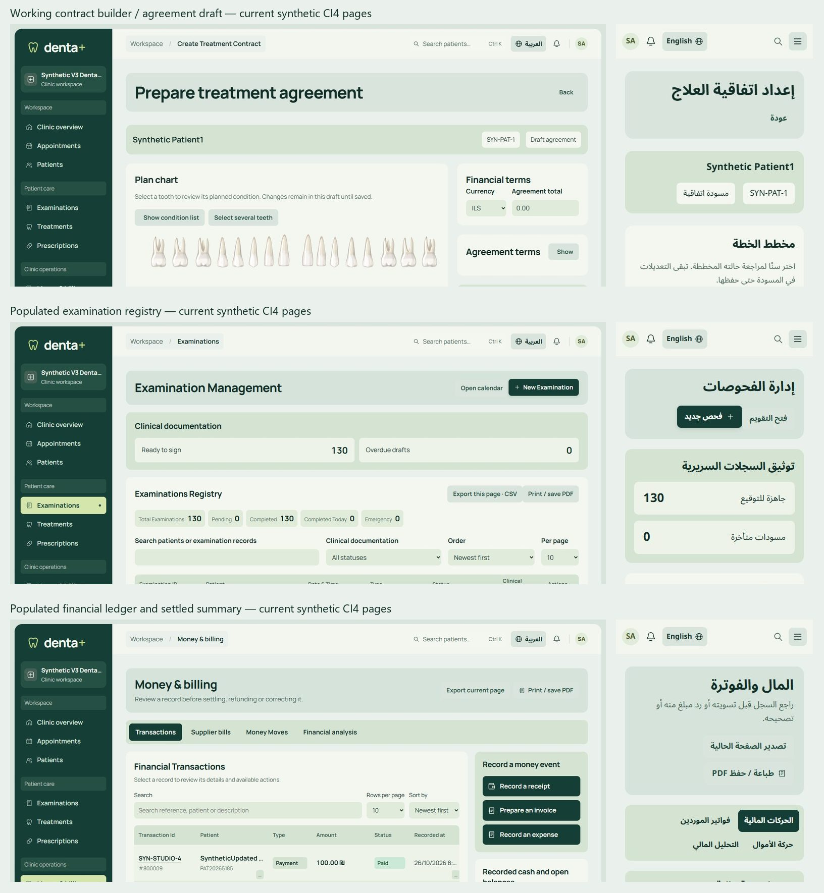
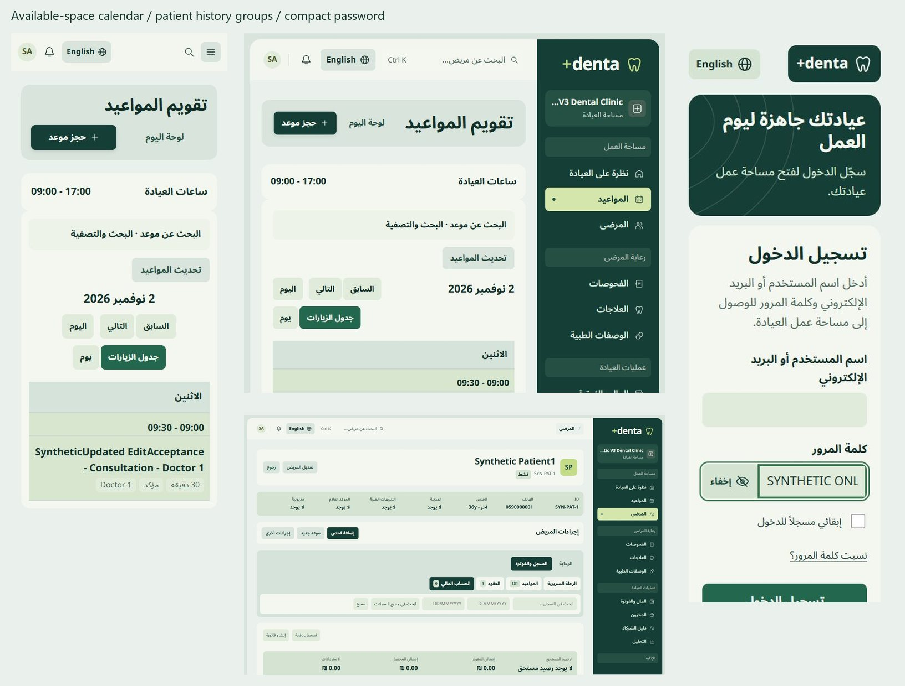
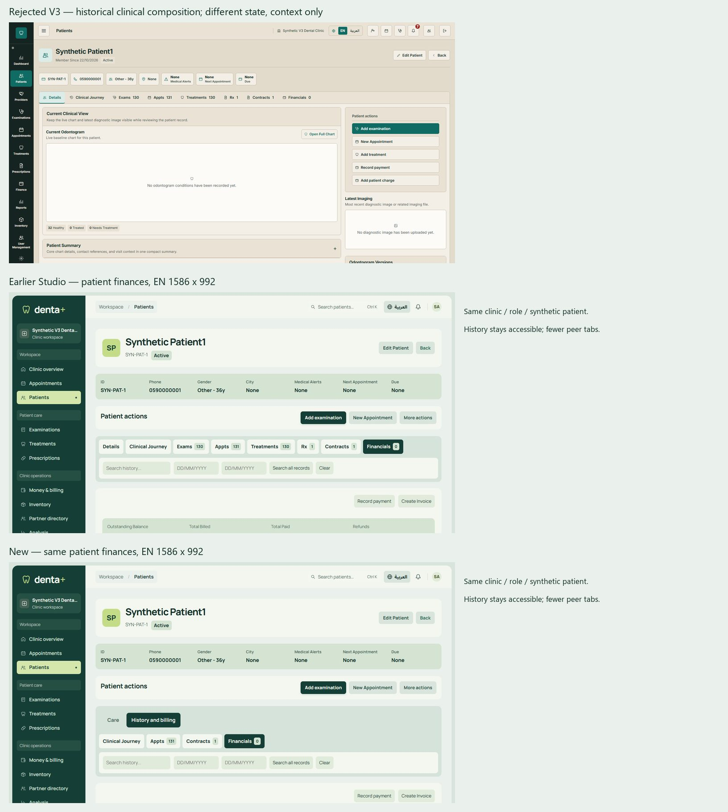

# Studio: current UX and bounded modularization

**Disposition: READY FOR OWNER VISUAL REVIEW of the delivered frontend pass; NOT READY for whole-PR functional/release acceptance.** Owner full visual acceptance, fresh independent exact-head review, successful isolated critical mutation certification and the disclosed clinical workflow blockers remain outstanding. No merge/deploy requested.

Started from clean `0d86f59d78395c3d417b9a63b6b8d0b2fc50f1fe` / `285d6a653cc4bc332ea690996bcebbbf6e8d4031`. Independent review5665529605 is COMMENTED with changes required, not approval. Protected release ref remains89352fd20e0d5166e81f631cb743bead1f596a68. No production access was used to make a fresh installed-server claim.

## Actual gallery, not prototype evidence

Full-size local gallery: `C:/Users/bassa/AppData/Local/Temp/denta-ui-v3-20261023/best-of-both/index.html` (double-click). Three portable sheets below total approximately0.69MB. Full captures, browser profiles, synthetic fixtures and raw diagnostics stay outside Git. Crops are labelled screenshot evidence; click for full resolution. Earlier local galleries remain intact.

### Genuine supported workflows

`/contracts` was an invalid test URL: there is no contract index route. Real `/contracts/create/1`, `/contracts/1` and `/contracts/1/edit` render200 in both locales. The sheets now use those actual synthetic routes. Finance and examinations previously appeared broken because the screenshot harness blocked their read-only POSTs; the canonical endpoints return populated200 payloads. The new finance capture waits for its separate stats request to settle. These facts prove reachable/populated UI, **not** draft item preservation or successful financial persistence.

### Context-sized agenda, history hierarchy and password

The same FullCalendar5 event source now uses listDay when the available calendar region is below680px, including constrained tablet workspaces. Desktop grid, date booking links, event inspector, stable provider identity, permitted actions and scheduling gate remain. The phone dayboard uses the same server appointment records, not invented stages or a second scheduling backend. The calendar's separate working-hours/context disclosure avoids large summary panels pushing its first record off-screen.

### Design lineage and matched comparison

Historical rejected V3 is shown for provenance at a different clinical state. It is **not** a controlled before/after comparison. The earlier Studio and current patient-finance captures share the same route, role, patient and1586×992 viewport. No rejected source was merged or restored as implementation authority.

## Gemini / independent-review reconciliation and pattern adoption

This matrix reconciles the actual claims supplied in the Owner's master brief and current GitHub review. It does not claim that missing standalone Gemini attachments, Mobbin, Figma, or an old-main runtime were inspected. Existing local reference/evidence and actual current CI4 source were used.

| Claim / pattern | Current finding | Decision and source evidence |
|---|---|---|
| Old485a198main is implementation truth | STALE / WRONG baseline | Preserve current release-derived branch and accepted Studio; no old-main overwrite |
| Replace shell/drawer/dashboard with pasted code | RISKY; invalid PHP example and missing contracts | REJECT; existing shells/permission filters remain; no new framework, HTML-fetch pseudo-SPA or script re-execution |
| Governed reusable CI4 units | USEFUL / PARTIAL before this pass | ADAPT existing primitives, named partials, safe JSON/configuration and documented APIs; [component catalog](../../UI_STUDIO_COMPONENTS.md) |
| Monolithic patient/finance/contracts/calendar | CURRENT; incremental extraction justified | Patient3891→1257, finance2059→990, contract1560→386, calendar586→133 main-view lines; code moved, not erased. Parameterized clinical/financial runtimes remain explicit limits |
| Mobile patient identity cards | ALREADY DELIVERED in0d86f59 | Preserve patient/chart record-first layouts and desktop grid contracts; no blanket table/card conversion |
| Mobile scheduler too cramped | CURRENT | ADAPT existing FullCalendar5 listDay using available region width, real event anchors and legible full-width records; [version-matched docs](https://legacy.fullcalendar.io/v5/list-view), [Jane scheduling/day-sheet task reference](https://jane.app/guide/working-with-the-schedule) |
| Eight equal patient history tabs | CURRENT | ADAPT Care / History and billing groups; keep every original panel/deep link. [WAI tabs](https://www.w3.org/WAI/ARIA/apg/patterns/tabs/) informs keyboard behavior; [Linear custom views](https://linear.app/docs/custom-views) informs task-specific views, not its business rules |
| Optional details switch / wrong clinical copy | CURRENT | REPLACE nameless reveal checkbox with real expanded/collapsed button; clinical/treatment scoped search and current-page export labels; [WAI disclosure](https://www.w3.org/WAI/ARIA/apg/patterns/disclosure/) |
| Password mobile label/RTL corners | CURRENT | Compact one-line caption, per-field accessible label retained; outer wrapper owns rounding while input text stays LTR; [GOV.UK password guidance](https://design-system.service.gov.uk/components/password-input/) |
| Native selects without affordance | CURRENT | Restore native appearance at offending selectors in directory/forms/context/finance/kiosk/money/notifications/stock; keep existing Select2 for actual large lookups |
| Global grid observer rescans | CURRENT | Queue only affected visible tables, idempotent wrappers, bounded metrics and disposal; no network or new data authority |
| Four KPIs, fake health/status/default chair/currency | UNSAFE / NOT an implementation requirement | REJECT new inferred facts. Existing clinical0/unassessed semantics remain separately documented; no new medical/finance policy or defaults |
| All drawers bottom sheets; automatic checkout | DESIGN JUDGMENT / UNSAFE blanket rule | REJECT; preserve task-appropriate drawers, full pages, explicit monetary review and real endpoint authority |
| Typography/radius/motion tokens absent | PARTLY TRUE | Add named foundation categories and use them in new components; do not claim all historical CSS values were migrated |
| CDN ownership/versions | CURRENT operational limitation | Retain existing pinned jQuery3.7.1/DataTables1.13.7 and FullCalendar5.11.3; no upgrade/install. Supply-chain integrity/local fallback remain separate work; failure UI is not offline certification |
| Contracts404 and finance/exam errors prove success | WRONG evidence | Correct route + allowlisted read harness, positive captures plus transient/denied/redirect cases; no false success claim |

## Component fit and route/state matrix

| Existing task | Actual flaw → implemented component | Focused outcome / evidence |
|---|---|---|
| Register patient / edit optional details | Reveal-as-switch → native disclosure button | Enter/Space and aria-expanded checked in EN/AR; original named fields/medical values retained |
| Enter password | Wrapped long caption and direction mismatch → compact suffix and wrapper geometry |320px AR one-line caption, hidden default/selection/paste contract retained, actual reveal checked |
| Clinical/treatment lookup | User/role and stock-export wording → scoped clinical labels | Real examination populated captures, treatment source reviewed; admin language unchanged |
| Patient care and money history | Competing peer tabs → two task groups with existing panel tabs | Financial deep link opens correct group; care has four peers; keyboard stays within visible group; no panels removed |
| Calendar / reception | Phone grid and five empty lanes → real agenda and compact context disclosure |320/390/820/1024/1586 available-space view and event inspector checks; time, identity and metadata legible |
| Agreements | Invalid gallery route and oversized source → real draft/view/edit routes + external unchanged builder |200 EN/AR; actual batch controls work at390/820/1586; no persisted agreement/signature mutation |
| Finance record | Inline click source and large embedded modals → explicit enumerated bindings + three fieldset partials | Original modal opens/closes, Escape restores focus; successful names30 unchanged; no payment/refund executed |
| Clinical/finance lists | Unbounded or ambiguous waits → shared delayed shapes, prior-result label, bounded read timeout/version/abort | Populated, transient error/retry, denied-cleared and rapid-search lifecycle checks; mutations are not cancelled/reinterpreted |
| Expired session | Redirected200HTML could leave stale identity → fail-closed access feedback | Five actual directories and clinic command search tested with synthetic redirects/denial; record links removed |
| Updated data tables | Global rescans → scoped queue/init/dispose | Three-run DOM fixture:80–88 prepares before vs10 after for ten updates; no duplicate wrappers/cells |
| Platform/settings/users/inventory | Preserve accepted compositions and authority | One62-route EN/AR shell/CSRF/reflow pass,436 assertions, no runtime errors; no new grants/configuration |
| Kiosk / immutable documents | Preserve privacy/evidence contracts | Kiosk native-select affordance only changed; earlier synthetic kiosk PIN/result/contract evidence reused and labelled in prior gallery. No new consent operation or claim of fresh end-to-end kiosk execution |

## Source parity, security and maintenance

- Named scope-sharing includes retain original DTO/local permission/validation variables. All original successful name attributes match after expanding includes: patient24, finance30, contract17. This is source-contract parity, not an assertion that every payload scenario was submitted.
- Original patient clinical/history runtime scripts remain byte-identical. Contract builder algorithm matches the original after replacing only its four PHP-produced values with safely encoded inert JSON; its original clinical paint block is separate from the pre-existing layout stylesheet. Native odontogram SVG/index/snapshot code and signed/print evidence were not changed.
- Removed enumerated inline handlers:19 finance,10 contract,1 calendar and13 patient navigation handlers. Seven patient handlers remain around preserved clinical/evidence-related behavior; fully externalized or zero-legacy claims are deliberately not made. New/extracted modules use no eval, untrusted innerHTML or downloaded script execution.
- Proven duplicate CSRF presenter consolidated. A stylesheet filename collision caught in the first visual pass was corrected by restoring the original layout asset exactly and giving the extracted native chart styles a distinct filename. No unrelated file reset/cleanup.
- Full changed view/asset byte totals and repeated raw sample summaries are in [acceptance.json](acceptance.json). Aggregate source grows modestly through explicit state handling/module ownership; main-file line reduction is not overall code deletion. No package/dependency/framework/migration added.
- Existing strict frontend source/coverage guard and SaaS guardrails pass without weakening allowlists. The SaaS guard notes an already-stale historical fixed-icon allowlist entry; zero current DOM sinks in views were detected. `campaign_complete=false` intentionally preserves Owner visual acceptance.
- All11 fingerprinted synthetic business tables remain identical before/after. Production/business databases, configuration, feature flags and durable customer records were not accessed or changed.

## Acceptance completed, with honest limits

-46 changed-workflow EN/AR assertions and18 captures;44 responsive/state checks across320,360,390,430,600,768,820,1024,1280,1366,1586,1920px on three flagship routes;62 tenant/platform route states with436 shell/CSRF/locale/reflow assertions.
- Nine final available-space calendar legibility/inspector checks; final compact RTL password checks; contract batch controls and finance Escape/focus verified at desktop/phone/tablet before the final password-only correction; six session-expiry/denied identity-clear checks. No JavaScript errors in completed receipts. Corrected harness/early implementation failures remain outside Git rather than erased or counted as passes.
- CSS-layout zoom at200/400% and forced-colors/reduced-motion spot checks are emulation, not native browser chrome zoom, a physical mobile keyboard, touch hardware, screen reader or third-party password-manager extension certification. Full physical AT/zoom/landscape matrix remains untested.
- Existing SQL/RBAC/tenant/Bearer-session/clinical/financial backend evidence is reused only for unchanged authority. This pass executed read-only actual routes and blocked business mutations. No claim of new successful registration, booking, finance settlement or signed clinical persistence certification; final isolated permitted/denied mutation acceptance remains a separate outstanding gate.

## Measured performance, not speed marketing

The earlier0.2549→0.00086 registry CLS was a controlled local loading-geometry correction, not an app-wide metric. Three new runs per dataset at390/1366 show actual sensitivity:

| Viewport / initial dataset | CLS range (three runs) | Median whole-document / TTFB |
|---|---|---|
|390 / populated|0.00563|498 /253ms|
|390 / bounded search|0.00563|441 /255ms|
|390 / empty|0.08682|393 /254ms|
|1366 / populated|0.00113|403 /262ms|
|1366 / bounded search|0.04081|384 /248ms|
|1366 / empty|0.04081|415 /271ms|

These use real synthetic SQL reads; harness overrides only the initial read search term, with no record writes. Query-count header remained143 for registry document requests. One filtered phone run took2409ms despite255ms TTFB, illustrating resource/load variability. Do not discard that outlier or claim a general speedup.

Patient care remained441 queries, local document719/992/803ms and TTFB505/808/615ms across three runs, with observed CLS0.0446–0.0532. The earlier2.6s sample was not reproduced as a stable invariant; substantial server work remains. No backend/query refactor was hidden in this UI pass. Field/widget and contract algorithms are now cacheable external assets, but no paired cold/warm production speed improvement is claimed.

The grid benchmark is separately controlled: eight25-row/four-column tables, ten updates to one table, three isolated runs per source. Prepare calls80–88→10; wall time139–233→135–140ms includes frame/tool overhead and is not INP. New opt-in lifecycle and idempotence reduce unnecessary DOM work, not database cost.

## Remaining acceptance and policy boundaries

1. Existing chart-history `tooth1`/`tooth-1` mismatch remains a clinical interpretation blocker for history preview. Native current interactive chart was preserved. No repair claimed.
2. Existing draft agreement item-sync defect remains a blocker for certifying agreement item persistence. A working page, original algorithm extraction and screenshot do not resolve it. No draft was saved to conceal the defect.
3. Clinical Unassessed/No/Yes semantics and historical interpretation require explicit clinical/Owner decision; see the separate proposal in the component catalog. No stored value/default was changed.
4. Successful isolated critical clinical/financial mutations, full AT/device matrix and current exact-head independent review remain uncompleted. The automated reviewer was quota-blocked; no repeated bot request or invented approval. Owner full visual acceptance remains separate.
5. CDN hardening, broader backend query optimization, remaining server-parameterized scripts and residual inline clinical/evidence handlers are explicit follow-ups, not claimed finished.

The delivered visual/source pass is available for Owner inspection. **Whole-PR final functional acceptance and release remain NOT READY.** No production, merge, migration or feature authorization is requested by this document.
